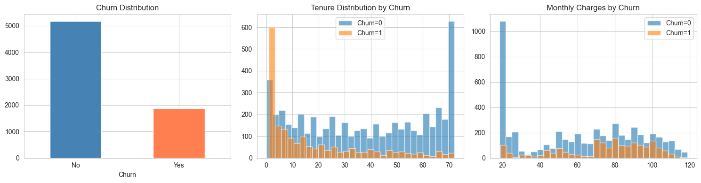
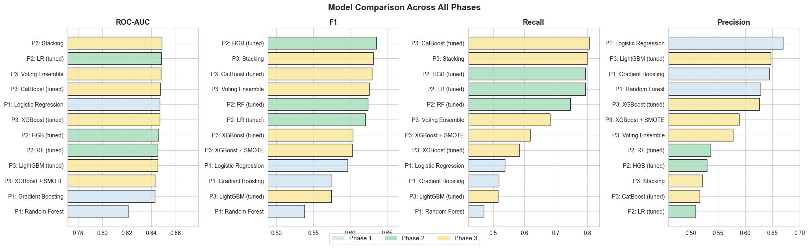
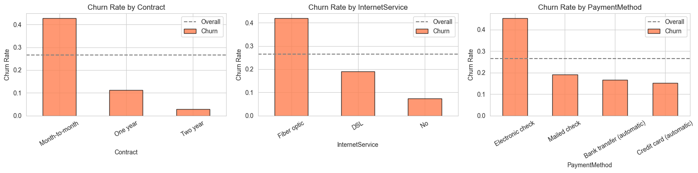
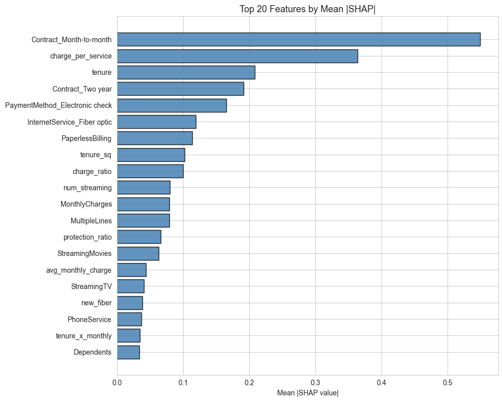
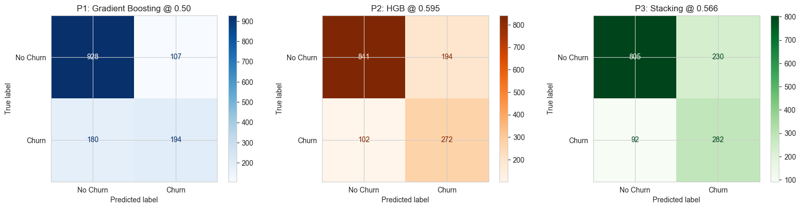
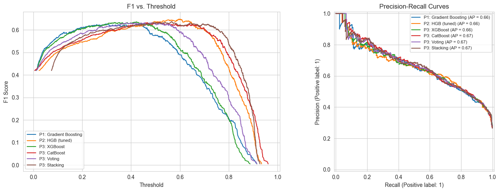

<div align="center">

# Telco Customer Churn

### Predicting which telecom customers are about to leave, from simple baselines to Bayesian-tuned gradient boosting


[Results](#-results) · [Key Findings](#-key-findings) · [Quick Start](#-quick-start) · [Project Structure](#-project-structure)

</div>

---

## 📖 Overview

This project predicts which customers will **churn** using the [Telco Customer Churn](https://www.kaggle.com/datasets/blastchar/telco-customer-churn) dataset.

| Customers | Features | Target | Class balance |
|:---:|:---:|:---:|:---:|
| **7,043** | **21 columns** (41 modeled after feature engineering) | `Churn` (yes / no) | 73.5% stay · 26.5% churn |

The project progresses through three modeling phases, from simple baselines to state-of-the-art gradient boosting with Bayesian hyperparameter optimization.

<div align="center">

<br><sub>Churners are concentrated at very low tenure, and there is a clear class imbalance.</sub>
</div>

---

## 🧪 The Three Phases

| Phase | Approach | Key additions |
|-------|----------|---------------|
| **1 · Baselines** | Logistic Regression, Random Forest, Gradient Boosting | No tuning, no class balancing |
| **2 · Tuned sklearn** | LR, Random Forest, HistGradientBoosting | `class_weight='balanced'`, `RandomizedSearchCV` |
| **3 · Advanced boosting** | XGBoost, LightGBM, CatBoost | Optuna (TPE), SMOTE, SHAP, voting + stacking |

---

## 📊 Results

| Phase | Best model | ROC-AUC | F1 | Recall | Runtime |
|:-----:|-----------|:-------:|:--:|:------:|:-------:|
| 1 | Gradient Boosting | 0.843 | 0.575 | 0.519 | ~2 s |
| 2 | HGB (balanced + tuned) | 0.846 | **0.636** | 0.794 | ~1.5 min |
| 3 | Stacking ensemble | **0.849** | 0.632 | **0.800** | ~1.5 min |

<div align="center">

<br><sub>Blue = Phase 1, green = Phase 2, yellow = Phase 3. ROC-AUC barely moves; F1 and recall jump once classes are balanced.</sub>
</div>

### The takeaway

> **The biggest gain is Phase 1 → Phase 2, from adding `class_weight='balanced'`.**
> Phase 3 confirms the performance ceiling with diminishing returns: runtime is similar to Phase 2, but the added complexity (three more libraries, ensembling) buys almost nothing.

Runtimes are from a single full run on a 10-core Mac (about 3 minutes end to end) and vary with machine load.

<details>
<summary><b>Full results at the default 0.50 threshold (all 12 models)</b></summary>

<br>

| Model | Accuracy | ROC-AUC | Precision | Recall | F1 |
|-------|:-------:|:-------:|:---------:|:------:|:--:|
| P1: Logistic Regression | 0.8070 | 0.8473 | 0.6700 | 0.5374 | 0.5964 |
| P1: Random Forest | 0.7857 | 0.8212 | 0.6286 | 0.4706 | 0.5382 |
| P1: Gradient Boosting | 0.7963 | 0.8430 | 0.6445 | 0.5187 | 0.5748 |
| P2: LR (tuned) | 0.7424 | 0.8484 | 0.5094 | 0.7941 | 0.6207 |
| P2: RF (tuned) | 0.7615 | 0.8456 | 0.5365 | 0.7460 | 0.6242 |
| P2: HGB (tuned) | 0.7587 | 0.8460 | 0.5304 | 0.7941 | 0.6360 |
| P3: XGBoost (tuned) | 0.7970 | 0.8473 | 0.6264 | 0.5829 | 0.6039 |
| P3: LightGBM (tuned) | 0.7970 | 0.8453 | 0.6477 | 0.5160 | 0.5744 |
| P3: CatBoost (tuned) | 0.7480 | 0.8474 | 0.5162 | 0.8075 | 0.6298 |
| P3: XGBoost + SMOTE | 0.7842 | 0.8437 | 0.5893 | 0.6176 | 0.6031 |
| P3: Voting Ensemble | 0.7835 | 0.8482 | 0.5782 | 0.6818 | 0.6258 |
| P3: Stacking | 0.7523 | 0.8488 | 0.5218 | 0.7995 | 0.6315 |

</details>

<details>
<summary><b>Best model per phase with the F1-optimal threshold</b></summary>

<br>

| Model | Threshold | F1 | Precision | Recall | ROC-AUC |
|-------|:--------:|:--:|:---------:|:------:|:-------:|
| P1: Gradient Boosting | 0.300 | 0.6261 | 0.5340 | 0.7567 | 0.8430 |
| P2: HGB (tuned) | 0.595 | 0.6476 | 0.5837 | 0.7273 | 0.8460 |
| P3: XGBoost | 0.423 | 0.6357 | 0.5856 | 0.6952 | 0.8473 |
| P3: CatBoost | 0.518 | 0.6346 | 0.5285 | 0.7941 | 0.8474 |
| P3: Voting | 0.492 | 0.6327 | 0.5787 | 0.6979 | 0.8482 |
| P3: Stacking | 0.566 | 0.6366 | 0.5508 | 0.7540 | 0.8488 |

The thresholds were tuned on the test set for simplicity; in production, tune them on a validation set.

</details>

---

## 🔍 Key Findings

### 1. What drives churn

<div align="center">

</div>

Top churn drivers, consistent across all model families:

| Rank | Driver | What the data says |
|:---:|--------|--------------------|
| 1 | **Contract type** | Month-to-month customers churn at ~3x the rate of annual contracts |
| 2 | **Tenure** | Customers in their first 6 months are the highest-risk group |
| 3 | **Internet service** | Fiber optic customers churn more (higher charges, possible quality gap) |
| 4 | **Payment method** | Electronic check correlates with higher churn |
| 5 | **Protection services** | Customers without security, backup or support services leave more often |

<div align="center">

<br><sub>SHAP importance for the tuned XGBoost. The engineered <code>charge_per_service</code> ranks second, behind month-to-month contracts.</sub>
</div>

### 2. Class weighting beats everything else

Without class weighting, models catch only about half of churners (recall 47 – 54%). Adding `class_weight='balanced'` lifts recall to about 75 – 80% and F1 from ~0.55 to ~0.63, a larger gain than any algorithm change.

<div align="center">

<br><sub>Best model per phase (P1 at the default 0.50 threshold; P2 and P3 at their F1-optimal thresholds).</sub>
</div>

### 3. Thresholds and the ceiling

<div align="center">

<br><sub>The precision-recall curves of every model nearly overlap.</sub>
</div>

The default 0.50 threshold is arbitrary. The optimal threshold ranged from 0.30 to 0.60 depending on the model, and every model lands at a similar best F1 (about 0.63 – 0.65).

**The performance ceiling (~0.849 ROC-AUC) is a data limitation**, not a model limitation. All algorithms converge to the same band. Further improvement requires richer features (usage logs, complaint history, time-series behavior).

---

## 🚀 Quick Start

```bash
# 1. Create and activate a virtual environment (Python 3.11+)
python3 -m venv .venv
source .venv/bin/activate        # Windows: .venv\Scripts\activate

# 2. Install pinned dependencies
pip install -r requirements.txt

# 3. (Optional) register a Jupyter kernel
python -m ipykernel install --user --name data_churn --display-name "Python (data_churn)"

# 4. Open the notebook and run all cells (~3 minutes)
jupyter lab Churn_DA.ipynb
```

---

## 🗂 Project Structure

```
data_churn/
├── telco_churn.csv            # Raw dataset
├── Churn_DA.ipynb             # All three phases: baselines → tuned sklearn → XGB/LGB/CatBoost
├── requirements.txt           # Pinned dependencies
├── README.md                  # This file
└── images/                    # Figures used in this README
```

---

<div align="center">

**See also:** the [regression counterpart](https://github.com/andreslunagodoy/data_clv), predicting customer lifetime value with the same pipeline.

</div>
